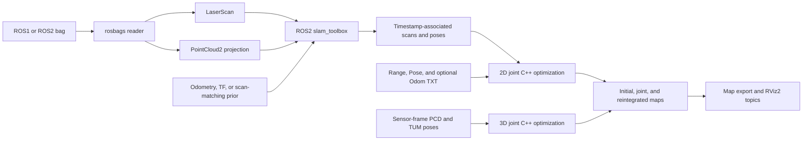

# Processing pipelines

This document describes the ROS2/C++ branch. Installation and executable examples are in the [README](../README.md).

## Data flow



## 2D text adapter

`tools/txt_pipeline.py` accepts original Range/Pose/Odom text files or an input profile. It validates scan geometry, chooses the configured initialization, selects frames, composes skipped SE(2) odometry increments, and writes the prepared observations and effective backend configuration. It then invokes `occupancy_slam_2d` through the shared backend runner.

Text input directly enters the C++ backend. `ModeMulti` selects the single-grid or coarse-to-fine path. See the [configuration reference](../config/README.md) for initialization, solver settings, and the intentional N approximation.

## Bag adapter and frontend

`tools/rosbag_pipeline.py` reads ROS1/ROS2 bags using Python `rosbags`; ROS1 and `ros1_bridge` are not required. LaserScan measurements retain their angular geometry. PointCloud2 measurements are transformed to the configured projection frame, filtered by height/range, and binned by azimuth to form horizontal scans.

The frontend needs an odom-to-base prior. It can use an Odometry topic, TF, or scan-to-scan ICP. The ICP option supplies a motion prior; actual scan matching and mapping still run in `slam_toolbox`. Large inter-scan motion and weak geometry can reduce the reliability of this prior.

The adapter feeds a virtual scan topic to `slam_toolbox` and associates returned poses with scan timestamps. Startup scans without an exact pose match are recorded as skipped. The accepted-fraction threshold is configurable. Pose increments derived from the frontend trajectory are correlated with that trajectory and are identified in the input manifest.

The backend initialization is the trajectory observed during frontend processing. The serialized pose graph is saved separately; final loop-closed graph poses are not re-exported to replace all earlier poses. Changing the frontend changes the backend's input and must be accounted for in experimental comparisons.

For a public bag example, see the [Cartographer Revo LDS dataset](https://google-cartographer-ros.readthedocs.io/en/latest/demos.html#revo-lds). Download the bag separately, inspect its topics, and pass its path to the bag adapter.

## 3D backend

`tools/pcd_pipeline.py` accepts an NC20-style directory or an explicit PCD timestamp manifest with TUM poses. `occupancy_slam_3d` reads sensor-frame scans through PCL, applies the configured filtering/downsampling, and constructs sparse occupancy observations. The optimization jointly estimates SE(3) poses and grid variables.

The C++ implementation includes sparse grid allocation, interpolated occupancy residuals, pose constraints, regularization, fixed gauge, and iterative linear solving. It is distinct from the preliminary MATLAB implementation in [C_plus_plus/3D_Preliminary](https://github.com/WANGYINGYU/Occupancy-SLAM/tree/C_plus_plus/3D_Preliminary), which includes additional research options and joining code. These implementations should be identified separately in reported experiments.

## Build and runtime environments

`tools/build.sh` builds the C++ applications and tests. `tools/build_rviz.sh` builds the optional ROS2 grayscale Map display. CMake supports `BUILD_3D`, `BUILD_TESTING`, and `LIBIGL_INCLUDE_DIR`; see the main README for dependencies.

`tools/env.sh` loads the system ROS2 setup at `/opt/ros/${ROS_DISTRO:-jazzy}/setup.bash`. Set `OCCUPANCY_RUNTIME_SETUP` explicitly for a different ROS installation. The built RViz overlay is loaded from `build/rviz_install` or `OCCUPANCY_RVIZ_PREFIX`. No local `.runtime` directory is needed.

The public wrappers automatically invoke `tools/run.py`. Set `OCCUPANCY_WORKSPACE` to a writable directory or use the default `~/occupancy-slam-workspace`. The launcher creates `runs/<name>/`, changes its working directory there, and places temporary files, caches, and ROS logs below that run. Display-map caches are shared under the workspace's `cache/` directory. For direct Python tools, use the launcher explicitly:

```bash
python3 tools/run.py --name evaluation_run -- \
  python3 "$PWD/tools/evaluate_2d.py" \
  --result /absolute/pipeline --ground-truth /absolute/gt.txt --output evaluation
```

`tools/run.py --workspace /absolute/output_directory` overrides the environment for that invocation. Source/script/input paths passed to the launcher must be absolute because it changes the working directory. Existing results can be viewed from any readable directory; they need not be moved into the workspace.

## Installed C++ API

CMake installation includes executables, public headers, libraries, profiles, Python tools, and the `occupancy-slam` entry point. Consumers may use `find_package(OccupancySLAM REQUIRED)` and link `OccupancySLAM::occupancy_2d_core` or `OccupancySLAM::occupancy_3d_core`.

The main modules are `src/optimization/`, `src/io/`, `src/mapping/`, and `src/apps/`. Original 2D numerical functions remain in `SubFuncs.cpp` and `FuncConvertObs.cpp`. The standalone interactive GUI is maintained on `C_plus_plus`.
