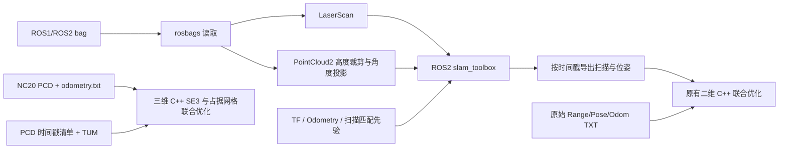

# TXT、ROS bag 与三维 PCD 输入

工程位置：`/home/yingyuwang/Documents/Occupancy-SLAM`。基于上游提交 `705b2178f2d6f863a85d1705a6631389b9a8de9a`，保留二维论文的残差/Jacobian 和 N 近似更新；修正求解器参数生效、诊断和模块边界，MATLAB 文件保留。新增两个 C++ 可执行程序和 ROS2 离线驱动。无须安装 ROS1 或 ros1_bridge。

## 已实现的输入流程



`slam_toolbox` 是 ROS2 可安装的 SLAM 包，本机 ROS2 Jazzy 最初未安装它。这里使用数据盘局部运行环境，未修改系统 ROS 安装。`slam_toolbox` 需要 odom→base 先验；它输出 `/pose` 和地图，不能直接假定会发布 `nav_msgs/Odometry`。本工程从其 `/pose` 计算相邻帧 SE(2) 增量，提供给二维优化。

无 odometry 的 bag 使用二维扫描间 ICP 产生先验，再调用真正的 slam_toolbox 扫描匹配与建图。该 ICP 不替代 slam_toolbox，也不用于三维优化。大位移、快速转动或退化场景需要调整 `--icp-distance`、提高输入频率，或提供外部 odometry。

## 环境和构建

本机已构建 `build/occupancy_slam_2d`、`build/occupancy_slam_3d` 和原有交互程序 `build/Occupancy_SLAM`。依赖：Eigen 3.4、OpenMP、libigl 头文件（OpenCV 仅原交互程序需要）；三维另需 PCL；bag 流程另需 ROS2 Jazzy、slam_toolbox、Python numpy/scipy/PyYAML/rosbags。

- `third_party/libigl`：已下载 v2.5.0，或通过 CMake 的 `LIBIGL_INCLUDE_DIR` 指定现有头文件。
- `.runtime`：指向数据盘 `occupancy_runtime_20261019_01`，其中有 Python venv 和局部解包的 ROS2 slam_toolbox/Ceres 运行依赖。
- `tools/env.sh`：优先加载 `.runtime/setup.bash`；也可以通过 `OCCUPANCY_RUNTIME_SETUP` 指定其他环境，否则加载系统 Jazzy。
- `tools/bootstrap_local.py`：在启动器创建的运行目录内重建局部运行环境；运行结束打印 `setup.bash` 路径。重新安装后设置 `OCCUPANCY_RUNTIME_SETUP` 或更新 `.runtime` 链接。

**所有实验从下述工作目录使用数据盘启动器运行。`--name` 必须每次使用新名称；源代码／脚本／配置输入使用绝对路径。** 相对输出在数据盘运行目录内。不要从工程目录直接运行实验，也不要为实验指定 home、源代码树或 `/tmp` 输出。Fast DDS 配置为 UDP，避免共享内存传输写入 `/dev/shm`。

```bash
cd /home/yingyuwang/Documents/ws_SDF_BA/src
python3 sdf_ba/tools/run_on_data.py --name occupancy_build_new -- \
  bash /home/yingyuwang/Documents/Occupancy-SLAM/tools/build.sh
```

构建产品在项目 `build/`，编译临时文件由启动器放到数据盘。新机器可先用发行版包安装 ROS2 slam_toolbox；本机无需再安装。

## 二维：原始 TXT 与参数目录

原始 `Range.txt + Pose.txt`、`Range.txt + Pose.txt + Odom.txt`、`Range.txt + Odom.txt` 均可通过 `tools/run_2d.sh txt` 直接进入 C++ 后端，输出与 bag 流程相同的 pipeline 目录，可用当前 RViz 查看。原版每行扫描、每行 `x y yaw` 位姿格式保持不变。

```bash
cd /home/yingyuwang/Documents/Occupancy-SLAM
./tools/run_2d.sh txt --config config/inputs/txt.yaml --max-scans 20 --resolution 0.3 --iterations 3
./tools/run_2d.sh bag --config config/inputs/rosbag_laserscan.yaml --bag /absolute/input.bag
```

入口自动使用本机数据盘启动器。可编辑配置集中在 [config/](../config/README.md)：TXT 路径与原版扫描几何、LaserScan/PointCloud2 的 bag topic、动态/静态 TF topic、里程计 frame、投影高度范围以及本地 slam_toolbox 设置。完整格式、路径解析、原版模式边界、输出与示例见该文档。直接调用 `rosbag_pipeline.py` 时也可使用 `--config`，旧的命令行参数继续可用。

## 二维：Cartographer 官方 demo

本机已下载 [Cartographer Revo LDS demo](https://google-cartographer-ros.readthedocs.io/en/latest/demos.html#revo-lds)：

`/media/yingyuwang/Data/experiments/sdf_ba/codex_runs/occupancy_cartographer_data_20261019_01/cartographer_paper_revo_lds.bag`

该 bag 只有 `horizontal_laser_2d` LaserScan，没有 TF/odom。首帧不完整，因此明确使用 `--start 1`；这里的索引从 0 开始。

```bash
cd /home/yingyuwang/Documents/ws_SDF_BA/src
python3 sdf_ba/tools/run_on_data.py --name occupancy_revo_demo_new -- bash -c '
  source /home/yingyuwang/Documents/Occupancy-SLAM/tools/env.sh
  python /home/yingyuwang/Documents/Occupancy-SLAM/tools/rosbag_pipeline.py \
    --bag /media/yingyuwang/Data/experiments/sdf_ba/codex_runs/occupancy_cartographer_data_20261019_01/cartographer_paper_revo_lds.bag \
    --output pipeline --start 1 --max-scans 80 --beam-stride 2 \
    --resolution 0.2 --iterations 5
'
```

`--max-scans 0` 表示处理全部选中帧。大 bag 建议先用短片段验证话题和外参，再逐步增加长度。完整二维后端为稠密范围内的稀疏求解，内存随地图范围和射线观测数量增长；超过 1000 万网格节点会明确报错，可提高 `--resolution` 或分段处理。

## 二维：自有 bag

推荐先编辑 `config/inputs/rosbag_laserscan.yaml` 或 `rosbag_pointcloud.yaml`，使用 `run_2d.sh bag --config ... --bag ...`。话题映射包括 `scan_topic/odom_topic/tf_topic/tf_static_topic`，不需要改代码。

先通过 `tools/inspect_bag.py /绝对路径/input.bag` 查看话题。命令同样放在上述 `run_on_data.py ... -- bash -c 'source .../env.sh; python ...'` 中。

| 输入情况 | `rosbag_pipeline.py` 的关键参数 |
|---|---|
| LaserScan 与 TF | `--scan-topic /scan --odom-source tf --odom-frame odom` |
| LaserScan 与 Odometry | `--scan-topic /scan --odom-source odom --odom-topic /odom --odom-frame odom` |
| LaserScan 无 odometry | `--scan-topic /scan --odom-source scan-match` |
| PointCloud2 与 TF | `--scan-topic /points --odom-source tf --projection-frame base_link --min-height -0.2 --max-height 0.2 --bins 720` |
| PointCloud2 无 odometry | `--scan-topic /points --odom-source scan-match --min-height -0.2 --max-height 0.2 --bins 720` |

默认 `--odom-source auto` 优先使用指定 Odometry 话题，其次可用 TF，最后扫描匹配；最终选择写入日志和 `summary.json`。同一 bag 中若有多个激光／点云话题，必须指定 `--scan-topic`。

**坐标和同步：**

- PCD/PointCloud2/LaserScan 的坐标单位为米，角度为弧度。
- 默认以扫描自身坐标系的 XY 平面建图。PointCloud2 高度相对该坐标系；安装有倾角时，指定 `--projection-frame`，先通过 bag 中 TF 转换再裁剪。
- Odometry 的 `child_frame_id` 与扫描 frame 不同时，必须有对应外参 TF；缺失时明确报错，不隐式使用单位外参。
- TF 使用扫描的 header 时间戳，位置线性插值、姿态四元数插值；不外推。`--tf-max-gap` 默认 0.2 秒，限制插值两侧样本距扫描时刻的距离。
- 送入 slam_toolbox 的虚拟 `base_frame` 与扫描 frame 一致，避免把机器人 base 位姿错误地应用到激光点上。`Pose.txt` 和最终轨迹也是此扫描／投影坐标系的位姿。
- 不进行扫描内部运动畸变补偿；PointCloud2 中的 per-point time/ring/intensity 不参与投影。
- 每帧等待相同 header 时间戳的 `/pose`，未接收帧写入 `scan_acceptance.json`；至少保留 2 帧且满足 `--min-accepted-fraction`（默认 0.8）才调用后端。Jazzy 2.8.5 会跳过启动时的第 2–4 帧。
- `/pose` 是当时的 SLAM 位姿，之后的回环不会追溯更新此前发布的消息。导出的初始化是因果轨迹；另保存最终 `slam_graph.posegraph`/`.data` 供后续使用，不将因果轨迹声称为最终回环优化图的全部节点位姿。
- `--domain-id` 默认 87，供这次离线运行隔离 ROS 通信；并发实验请使用不同值。

**二维后端：**新增 `occupancy_slam_2d` 调用原有 `FuncConvertObs`、`FuncInitialiseGridMap`、`FuncDiffJacobian`、`FuncDelta`、`FuncUpdate` 和计数图更新。它固定首帧、同时优化位姿与网格，采用单分辨率完整网格，不启用原交互程序的多分辨率选择阶段。N 的近似导数和迭代后重算保持原样。共享地图累加改为确定性的串行循环，批处理入口继续固定单线程；求解器采用配置的实际迭代上限/容差并记录状态。

`--odom-weight` 控制由 slam_toolbox 相邻位姿导出的 odometry 约束，默认 0.1；置 0 只保留位姿初始化。不要把它视为独立于初始化的另一份传感器测量。上游二维迭代的观测误差不保证逐次单调，观测及目标函数代价记录在 `iterations.csv`（不等于真实精度误差），不据此宣称轨迹精度改善。

主要输出在 `pipeline/`：

- `Range.txt`、`Pose.txt`、`Odom.txt`、`timestamps.txt`：严格按接收帧对齐。
- `input_odometry.txt`：输入 slam_toolbox 的先验，含所有选中扫描；行数可能多于接收帧数。
- `scan_acceptance.json`、`arguments.json`、`slam_toolbox.yaml`、`backend_config.txt`、两阶段日志：实际运行参数和帧记录。
- `optimized/trajectory.tum`、`poses.txt`、`map.pgm`、`map.yaml`。
- `optimized/occupancy.txt` 与 `normalization.txt`：原有模型的网格值和归一化计数；PGM 显示其比值的 logistic 概率。

## 三维：直接使用 NC20_Segment

每个序列是 `odometry.txt` 和 `PCD/full0.pcd, full1.pcd, ...`。odometry 每行：

```text
timestamp tx ty tz qx qy qz qw
```

第 i 行是 `PCD/full{i}.pcd` 的**绝对传感器位姿**，表示 `T_world_sensor`，不能传相邻帧增量。PCD 必须是对应传感器局部坐标，不能预先变换到 world。若给的是机体 odometry，应事先右乘 `T_body_sensor` 后提供。四元数需接近单位长度；时间戳必须递增。

```bash
cd /home/yingyuwang/Documents/ws_SDF_BA/src
python3 sdf_ba/tools/run_on_data.py --name occupancy_nc20_demo_new -- \
  /home/yingyuwang/Documents/Occupancy-SLAM/build/occupancy_slam_3d \
  --dataset /home/yingyuwang/Documents/ws_SDF_BA/data/NC20_Segment/Short_Exp \
  --output result --start 20 --stride 5 --max-frames 12 \
  --voxel 0.5 --point-voxel 0.4 --point-stride 2 --max-range 40 \
  --free-samples 4 --iterations 10 --check-jacobians 1
```

这个例子使用原始帧号 20, 25, ..., 75，位姿也取同样行，避免降采样造成错配。`--max-frames 0` 为全部；`--stride 1 --point-stride 1` 取消这两项抽样。PCD 支持 ASCII、binary、binary_compressed，自动读取 xyz，忽略附加字段并过滤非有限点。

其他命名方式使用 `--poses /absolute/trajectory.tum --manifest /absolute/scans.txt`：

```text
1583836591.877044201 /absolute/pcd/scan_a.pcd
1583836592.377257347 PCD/scan_b.pcd
```

相对 PCD 路径相对于清单目录。按时间戳最近邻匹配，默认容差 `--max-time-diff 0.05` 秒；不允许复用同一位姿行、不外推。没有清单时，按 NC20 的原始行号对应 `full{i}.pcd`。

### 三维 C++ 的优化定义

这是新的可运行 C++ 稀疏占据模型，**不是对 `3D_Preliminary/` 全部 MATLAB 选项的逐行移植**。当前实现：

1. 对每条有效射线生成命中观测（log-odds `log(0.7/0.3)`）和有限数量的自由空间观测（`log(0.4/0.6)`），每条射线的自由空间总权重为 1。
2. 在初始化观测周围建立带一格邻域的稀疏网格，对每个观测作三线性插值。网格变量表示归一化连续 log-odds；邻接顶点平滑权重默认 0.01，另有 `1e-6` 的零值正则。
3. 联合求解所有网格变量与除首帧外的 SE(3) 位姿。相邻帧相对运动由输入绝对位姿计算；默认平移和旋转残差乘子分别为 5/m、10/rad，可通过 `--odom-translation-weight` / `--odom-rotation-weight` 调整。
4. LM 阻尼和稀疏共轭梯度求解。试探步必须降低完整目标，超出已有插值支撑时拒绝该步，不删除困难残差来制造下降。当前网格支撑固定，因此需要合理初始化；不会自动扩展到很远的新区域。
5. `--check-jacobians 1` 检查所选位姿／地图导数与有限差分，跳过处在网格面上的不可微单侧导数点。

当前没有自动三维回环检测、多分辨率层次结构、MATLAB 的 NDT/截断区域/子图 joining 等模式。三维是局部批量联合优化，不将 ICP 拼接作为替代。完整长序列的时间、内存和轨迹精度尚未验收；默认最多 200 万稀疏顶点，超出会报错，适合先运行片段。

输出：`trajectory.tum`、`selected_scans.txt`、`optimized_points.pcd`、`occupancy_vertices.pcd`、`iterations.csv`、`summary.json`。前者是经滤波的输入点按优化位姿拼接；后者是优化网格顶点，`intensity` 为占据概率，不是表面 mesh。坐标均恢复到输入 world 坐标系。

## 重新运行测试

```bash
cd /home/yingyuwang/Documents/ws_SDF_BA/src
python3 sdf_ba/tools/run_on_data.py --name occupancy_tests_new -- bash -c '
  source /home/yingyuwang/Documents/Occupancy-SLAM/tools/env.sh
  python /home/yingyuwang/Documents/Occupancy-SLAM/tests/integration.py
'
```

测试创建的 ROS1 bag、PCD、运行日志和优化输出只在启动器的 data-disk 运行目录。测试真正启动 slam_toolbox，再运行 C++，包含非零激光外参、TF 插值、PointCloud2 大端／行填充、ASCII／压缩 PCD 和输入错误处理。

## RViz2 查看结果

计算完成后，使用 `tools/view_rviz.sh 2d --result /absolute/path/to/pipeline` 或 `tools/view_rviz.sh 3d --result /absolute/path/to/optimized`。可选 `--initial` 对比零迭代输出。完整 topic、操作、本机 demo 入口与数据盘日志说明见 [RVIZ.md](RVIZ.md)。

后端现在自动导出 `initial/`、`joint/` 和 `reintegrated/`，分别为优化前、直接优化的占据变量、固定最终 pose 从零重建。RViz 默认在同一坐标系显示一张地图，通过原生显示项的 `Topic` 下拉框切换三种结果。具体格式与公平对比条件见 [MAP_OUTPUTS.md](MAP_OUTPUTS.md)。

## 库、运行状态与地图导出

当前结构及安装/测试入口见仓库 README。二维/三维核心均不依赖 ROS；二维核心还独立于 OpenCV/PCL。三维 PCD I/O 单独链接 PCL，旧 OpenCV GUI 通过 `BUILD_LEGACY` 选择构建。二维与三维保留各自模型，不强行统一占据变量含义。

二维 `iterations.csv` 分开保存更新前、固定 N proposal 后、N 重算后的代价，并记录实际线性迭代次数和相对残差。`summary.json` 提供 `stop_reason`、`normalization_updates`、`inexact_linear_solves`、`objective_increased`。默认 `legacy` 没有下降保证；`decrease` 只检查固定 N 的 proposal，不修改论文近似或 N 刷新时机。

结果消费以 `map_outputs.json` 中的路径为准，根目录重复文件仅为兼容。高分辨率显示地图可独立生成：

```bash
./tools/occupancy-slam export --result /absolute/pipeline --resolution 0.1 --output display_010
```

该命令不导入 ROS、不运行优化。新 TXT/bag 流程会自动导出默认 0.05 m 地图；查看器在需要其他分辨率时先执行同一个独立导出阶段。ROS 发布层只加载结果和已导出的网格。

当前仍是有观测数量限制的离线批处理系统，没有把原 MATLAB submap joining 移植为新的 C++ 全局在线 SLAM。新增预算、射线数组预分配、PCD 时间戳二分查找解决明确的分配/匹配问题；没有据此宣称全序列实时性能。


## MATLAB 二维 simulation 输入

`tools/convert_matlab_simulations.py --source /绝对路径/Downloads --output /数据盘/converted` 读取 `Simu*_Data` 下的 v5 和 v7.3 MAT。后者需要 `requirements-matlab.txt` 的 h5py。转换保存每条射线的传感器局部 XY 端点，因此保留角度噪声；该端点入口的自由采样会按优化网格重新生成，不能作为原 MATLAB 全部观测的等价输入。精度对齐应另外用 `export_matlab_samples.py` 导出并选择 `--samples`。原始 MAT 只读。

C++ 输入选项 `--endpoints Endpoints.txt`、`--ranges Range.txt` 和 `--samples Samples.bin` 三选一。端点 TXT 的每行为 `frame_index x y`，帧编号从 0 开始并有序；Pose 每帧一行 `x y yaw`。转换结果同时保存 `Endpoints.npz`（键 endpoints，形状 N×B×2），供 ROS-free 显示导出读取；独立 0.05/0.1 m 显示建图也直接使用这些端点。不能将带角度噪声的点强制转换为固定角度 Range 后宣称观测未变。

每份 noisy odometry 先按原局部增量约定积分为初值；每份 Cartographer Pose 原样保存。缺第一帧 Pose 的输入同时删去第一帧扫描、时间戳和对应 GT 行，不用 GT 补位姿。GT 保存在单独文件中，仅用于转换对应关系核验和后处理评价。当前定量入口使用提供的低频 Scan（264/268/364/372 帧），不另行抽帧，也不将高频 Raw 的 2640/2680/3640/3720 帧混称为优化帧数。

批处理和评价入口为 `benchmark_matlab_simulations.py`、`evaluate_simulation_maps.py`、`summarize_matlab_simulations.py`；所有命令均需经过本工程文档前述数据盘启动器。该实验使用已提供的 Cartographer 初值，不重新运行 slam_toolbox；ROS bag 前端链路由已有输入集成测试单独覆盖。参数、完整复现命令、41 组实测结果和限制见 [VALIDATION.md](VALIDATION.md)。

原始样本二进制格式为 little-endian：一个 uint64 帧数，每帧一个 uint64 样本数 n，随后是 n×2 个交错 XY float64，再随后是 n 个标签 float64。`--sample-start 1` 可在 Pose 缺首帧时显式跳过扫描首帧；保留帧数必须严格匹配 Pose，截断、非有限值或预算超限会报错。此格式保留样本与占据标签，不需要 MATLAB 运行时。

完整复现命令及原 MATLAB 与 C++ 的逐步对照见 `VALIDATION.md` 的精度复核条目。`simulation_matlab.txt` 是当前保存参数的参考运行，不声称自动恢复未提供的论文实验配置。
